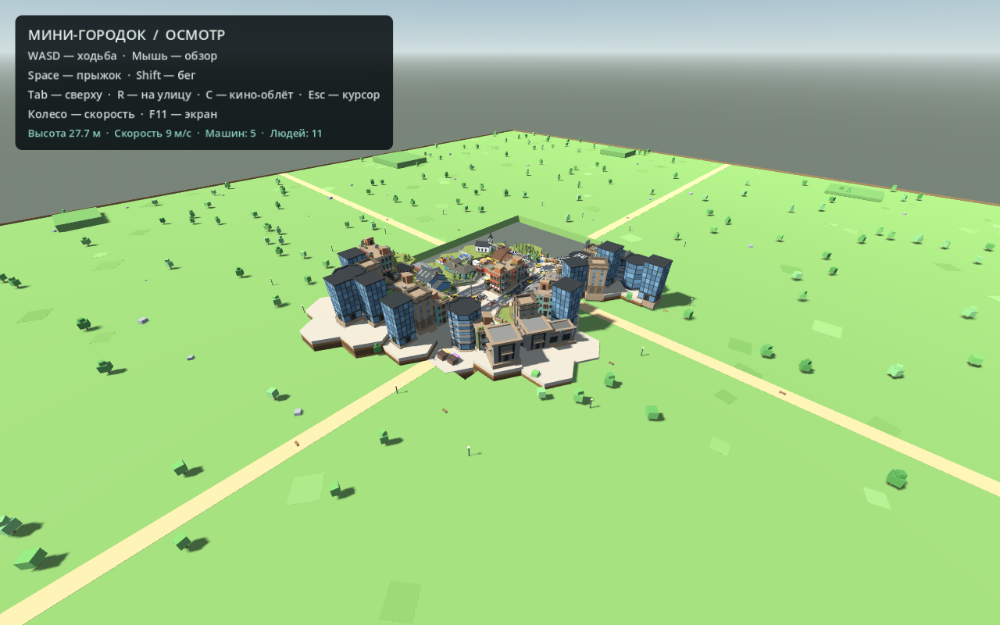

# Qadam — Кешкі аудан

Городская игра-повествование про жизнь нового района в Астане. Godot 4.4, интерфейс и диалоги — на казахском языке. Все модели находятся непосредственно в Git: Git LFS и повторное скачивание ассетов не требуются.

## Запуск

```sh
git clone https://github.com/yrn-dev/qadam.git
cd qadam
./run
```

Для Windows: `run.bat`. Голосовые разборы и озвучка настраиваются отдельно командой `./setup-voice` (необязательно — текстовый чат работает без них).

`./run` — открыть стартовое меню с медленным облётом района. В Godot: `godot/project.godot`, F5.

WASD — ходьба, мышь — обзор, Shift — бег, Space — прыжок, **E — войти / выйти у двери**, Tab — общий вид / обратно, R — начало (в помещении — ко входу), Esc — курсор и пауза, F11 — полный экран.

## Бос дүкен и голосовые разговоры

Четвёртый магазин без вывески находится между домами на западной стороне района. В телефоне есть кнопка **«Бос дүкен»**, которая строит путь к его двери. Внутри — пустой зал с продавцом Ермеком, без стеллажей, товаров и кассового стола. В разговоре доступна покупка за **1 000 000 ₸**, с отдельным подтверждением. Она списывает деньги один раз и сохраняет владение; после покупки объект отмечен как **«Менің дүкенім»**. Покупка мебели и товара — следующий этап, сейчас не реализована. Идентификаторы существующих домов не менялись.

В чате доступны **«Микрофон» / «Тоқтату»**, **«Қайта тыңдау»**, **«Қайталап айту»**, переключатель **«Дауыс»**. Запись начинается только по кнопке, длится до 30 секунд; распознанный казахский текст попадает в редактируемое поле и отправляется после нажатия «Жіберу». Можно сразу печатать. Приветствия и ответы NPC озвучиваются; мужские и женские варианты выбираются из шести голосов. Закрытие чата прекращает запись и звук. Упражнение сравнивает **распознанные слова** с образцом, а не оценивает фонетику или акцент; ошибки распознавания возможны. Исправление формулировок остаётся частью разговора с LLM.

Распознавание и озвучка работают локально: Vosk small Kazakh 0.42 + Piper/ISSAI high через sherpa-onnx, примерно 244 МиБ распакованных моделей. Они не используют платные речевые API и не отправляют аудио в сеть. Ответы LLM по-прежнему получает Alem. Локальный сервис на `127.0.0.1:18765` запускается только для микрофона или ещё не озвученного текста, ограничен двумя потоками для TTS и завершается вместе с запустившей его игрой либо после 10 минут без запросов. Транскрипции не пишутся в журнал сервиса; в историю беседы попадают только отправленные сообщения.

78 готовых озвучек приветствий и стандартных фраз уже находятся в `godot/assets/voice_lines/issai-high-v1-speed095/`. Для них модель не запускается. Новые ответы после первой озвучки сохраняются в `user://voice_cache/issai-high-v1-speed095/` и повторно проигрываются с диска, в том числе после перезапуска игры. Ключ учитывает текст, голос и версию синтеза: одинаковая фраза разными голосами хранится отдельно. Готовые записи работают и без установленных речевых моделей.

После изменения стандартных реплик обновить набор можно командами:

```sh
./run --headless --script res://voice_manifest.gd -- --shop-check
.voice-venv/bin/python voice/bake_lines.py
```

На этой машине всё установлено. На новой Linux-машине с Python 3.11 выполните `./setup-voice`, затем `./run`. Скрипт устанавливает зависимости в `.voice-venv` и проверяет SHA-256 загруженных моделей. Без речевых зависимостей текстовый чат продолжает работать. Карточка модели и источники лицензий находятся в `voice/`.

Проверки без скриншотов:

```sh
.voice-venv/bin/python voice/test_server.py
./run --headless --script res://shop_voice_check.gd -- --shop-check
./run --headless --script res://voice_cache_check.gd -- --shop-check
./run --script res://shop_voice_check.gd -- --shop-check --voice-live
```

Последняя проверка использует синтезированную тестовую фразу, а не запись микрофона: проверяет настоящий HTTP-путь TTS → аудио Godot, STT → поле чата, размеры кнопок, покупку, сохранение и маршрут до магазина. Реальную речь с вашего микрофона нужно проверить в игровом диалоге.

## Рабочий день и дом

09:00–18:00 проходят за **600 секунд активной игры**. Пауза и стартовое меню останавливают время. После 18:00 новые доставки недоступны; взятый заказ можно завершить и получить оплату. Вечер продолжается до сна, часы останавливаются на 23:59; новый день сам не переключается. Утреннее небо постепенно меняется на вечернее и ночное.

В любом из трёх магазинов наведитесь на **кассовый стол** и нажмите E: порция еды стоит 200 ₸. Наведение на кассира по-прежнему открывает разговор. Запас еды и долг видны в телефоне. Если на необходимую еду не хватает денег, порция выдаётся в долг, который удерживается из следующей оплаты доставки.

В своей квартире действия выполняются по E при наведении на соответствующий предмет: туалет → раковина → стол с купленной едой. В диван можно сесть и встать повторным E. После вечерних дел и завершения взятой доставки доступен сон у кровати: плавное затемнение, номер следующего дня, пробуждение в 09:00. Награды и ожидающая оплата сохраняются. В чужих квартирах домашние действия недоступны.

Ходьба — 1,85 м/с, бег — 5,4 м/с. Запас сил ограничивает непрерывный бег примерно восемью секундами; при ходьбе и отдыхе он восстанавливается. Индикатор появляется при расходовании сил. Сохраняются день, время, еда, долг, домашние дела и выносливость. Старое сохранение переносится на 09:00 того же игрового дня с сохранением денег, доставки, жилья и диалогов.

Проверка всего цикла без скриншотов:

```sh
./run --headless --script res://daily_life_check.gd -- --shop-check
```

## Меню и ручное сохранение

При запуске сначала показывается город с плавно движущейся камерой. «Ойынды бастау» / «Ойынды жалғастыру» возвращает управление игроку. В меню доступны управление, громкость, остановка движения камеры и выход. Игровое время в меню не идёт.

**Esc → S** или кнопка **«Ойынды сақтау · S»** сохраняет текущий прогресс и показывает «Сақталды». В обычной игре S остаётся ходьбой назад, в чате — вводом текста. Сохраняются положение игрока, направление взгляда и тип помещения. Продолжение работает на улице, в своём доме, в магазине и у получателя после передачи заказа. При занятом месте появления выбирается безопасная входная точка. Выход из стартового меню без начала игры не заменяет сохранённое местоположение. Сохранения старого формата без координат продолжаются с обычного места прибытия.

Телефон получил светлый экран, контрастный текст, выделенную текущую вкладку и прокрутку длинных страниц; кнопки вкладок остаются видны. В разговоре портрет и примеры фраз слева, история и отправка справа. Кнопка работы/оплаты выделена отдельно. Шрифты Noto включены в проект вместе с лицензией и поддерживают казахские буквы. Фокус клавиатуры выделяется золотистой рамкой.

Подготовка модели девушки обновлена: скрытая кожа определяется по поверхности авторской рубашки, а не только по высоте вершин. Анимации и сама одежда сохранены. Воспроизведение исправления: `python3 tools/repair_garments.py`, затем импорт Godot. Отчёт: `previews/garment_repair_report.json`.

Проверка меню и ручного сохранения без скриншотов: `./run --script res://menu_check.gd -- --shop-check`. Тест пишет только временный файл, сохранение игрока не меняет. Резервная копия: `backups/before-menu-ui/`.

## История, разговоры и телефон

Натан приезжает в Астану с 250 ₸ и мечтой открыть свой дүкен. Игра для практики казахского: интерфейс, задания, подсказки, вывески интерьеров и диалоги — на казахском. Начальный игровой цикл: разговор с Ерланом в BEREKE → работа курьером → доставка → возвращение за оплатой. Поздние главы полного сюжета (десять особых заказов, аренда, ремонт, собственный магазин) ещё не реализованы. STT будет отдельным этапом.

- Наведи центральную точку на человека с расстояния до 3,4 м и нажми **ЛКМ**. Откроется имя, 3D-портрет и чат. Enter отправляет сообщение, Esc завершает разговор. Стены мешают взаимодействию. Игрок не ходит при вводе текста, выбранный прохожий ждёт окончания разговора.
- 32 прохожих и 3 продавца имеют разные имена, характеры и системные промпты в `godot/npc_profiles.json`. `gemma4` отвечает на казахском, задаёт простые вопросы, мягко исправляет существенные ошибки. Кнопки фраз заполняют редактируемый черновик, а не отправляют ответ за игрока. Есть подсказки слов для знакомства, работы и доставки. Русского перевода больше нет.
- **F** — телефон: задача, деньги, бонусы, поступления и карта. **«Менің пәтерім»** на главной странице или **«Үйім»** на карте строят путь домой. Фиолетовая отметка — квартира Натана, зелёные — магазины, золотая — доставка. Карта использует реальные здания и пешеходные проходы. Масштаб меняется колесом и +/−, карта перетаскивается, «Ортаға» сбрасывает вид.
- Натану назначается одна доступная квартира рядом с местом прибытия. Её дверь сохраняется между запусками. Все остальные жилые двери закрыты, кроме адреса активной доставки. Своя квартира доступна всегда, в ней нет случайного получателя заказа.
- Для новой работы поговори по-казахски с **Ерланом в BEREKE**, затем нажми **«Курьер болып жұмысқа тұру»** и **«Тапсырыс алу»**. У остальных продавцов можно общаться; старый сохранённый работодатель сохраняется для совместимости.
- У нужной двери нажми **E**, зайди внутрь: там ждут один или два жильца из существующих мультяшных моделей. У них имена, портреты, отдельная история разговора и твёрдые коллизии. Посмотри на получателя и нажми **E**, чтобы передать заказ. ЛКМ открывает разговор. Передача с улицы, через стену или второму жильцу не засчитывается.
- После передачи можно выйти той же дверью. Вернись к своему работодателю и получи **700–1500 ₸ и 10 бонусов**. Оплата рассчитывается по длине пешего маршрута, округляется до 50 ₸ и фиксируется при выдаче заказа. Короткий путь до 30 м — 700 ₸, от 180 м — 1500 ₸. Сумма видна в задании и сохраняется. Деньги не начисляются у двери покупателя. Повторная передача и повторная оплата исключены; новый заказ доступен после расчёта. Бонусы пока накапливаются и показываются в телефоне; обмен на товар ещё не реализован. Ответы LLM не изменяют деньги или задания.
- Рабочая смена 09:00–18:00 длится 600 секунд активной игры. Пауза и потеря фокуса останавливают часы, телефон и чат — нет. Следующий день начинается после домашних дел и сна.
- Сохранение `user://story_v1.json`: деньги, время, работа, доставка, свой адрес, ожидающая оплата, бонусы, журнал, разговоры и текущее местоположение. Старые русские разговоры сохранены как архив; казахские идут отдельно (`kk_histories`). Деньги и старый прогресс не сбрасываются. Тесты с `--shop-check` не записывают сохранение игрока.

LLM: `https://llm.alem.ai/v1/chat/completions`, модель `gemma4`. Ключ — вне проекта: `user://llm.cfg`, секция `[alem]`, поле `api_key`, либо переменная `ALEM_API_KEY`. На этой машине файл имеет права 600. При ошибке сервиса черновик сохраняется для повтора, закрытие чата отменяет запрос. Для первого разговора и нового трудоустройства требуется связь с LLM; карта и уже начатые доставки работают без неё.

Проверки без скриншотов:

```sh
./run --headless --script res://story_check.gd -- --shop-check
./run --script res://story_check.gd -- --shop-check --live-llm
```

Проверяются закрытые двери, личная квартира и её маршрут, все пять интерьеров с жильцами, их коллизии и доступность, диалоги, полный цикл доставки/оплаты, защита от повторных наград и сохранение. Графический прогон также проверяет размеры казахского интерфейса и один реальный запрос. Резервная копия предыдущей версии: `backups/before-kazakh-housing/`.

## Звук

На улице слышна запись городского движения, а ближайшие машины и автобусы имеют пространственный звук мотора: направление и громкость зависят от положения, тон — от реальной скорости. На красном мотор переходит на холостой ход; за зданиями приглушается. Одновременно работают не более восьми моторных голосов, звуковая система не меняет маршруты или поведение транспорта.

Во всех трёх магазинах играет спокойная зацикленная музыка. При входе звучат дверь и тихий колокольчик, при выходе — закрытие двери. Музыка плавно появляется и затихает, улица внутри сильно приглушена. В пяти домашних интерьерах музыки магазина нет. Шаги используют шесть записей обуви Fantozzi (CC0), с чередованием левой и правой ноги и более мягкой обработкой дома. Ритм зависит от реального перемещения: около 2,1 шага/с при ходьбе и 2,9 при беге. Шаги прекращаются при остановке и на паузе; приземление звучит только после настоящего прыжка или падения, без ложного стука при появлении и телепортации. Подготовка: `tools/prepare_footsteps.py`; проверка: `./run --headless --script res://footsteps_check.gd -- --shop-check`.

**Esc** открывает паузу с отдельными ползунками общей громкости, музыки, улицы/машин и шагов/дверей. **M** выключает или включает звук. Настройки сохраняются в `user://audio.cfg`. При потере фокуса или на паузе звук плавно затихает; после возврата воспроизведение продолжается.

Все записи доступны по CC0; авторы, исходные ссылки и изменения указаны в `CREDITS.txt`. Готовые звуки занимают около 1,2 МБ, интернет игре не требуется. Исходники: `source/audio/`, подготовка: `tools/prepare_audio.py`, управление: `godot/district_audio.gd`. Резервная копия игровой точки входа: `backups/before-audio/compact_game.gd`.

Проверка: `./run --headless --script res://audio_check.gd -- --shop-check`.
Проверка реального аудиомикшера и запись выходного звука игры: `./run --script res://audio_check.gd -- --shop-check --record`; файлы `previews/audio_street.wav`, `audio_shop.wav`, `audio_home.wav`. Проверяются все 3 магазина и 5 домашних интерьеров, переходы, пауза, изменение тона мотора, шаги и лимит голосов.

## Активный район

Окружение увеличено на 30%: дома, три магазина, деревья, фонари, светофоры и Байтерек. Машины и автобусы, включая припаркованные, сохранены в прежнем размере. Планировка и зазоры увеличены согласованно с моделями и коллизиями. Рост жителей (1,78 м), размеры игрока, высота камеры (1,65 м) и скорость ходьбы сохранены. Коэффициент задаёт `ENVIRONMENT_SCALE` в `godot/district_layout.gd`; резервная копия — `backups/before-environment-scale/`. Проверка: `previews/environment_scale_check.log` — 600 секунд при 60 Гц, все машины движутся, максимальная остановка 42,38 с, 212 проездов перекрёстков; пересечений габаритов машин не обнаружено.

- Доступная территория 140,4 × 182 м; улицы шириной 9,62 м. Плотные фасады и небольшие проходы между домами. 102 здания вместе с недоступной фоновой застройкой; периметр закрыт рядами домов. Сплошной пол без разрывов.
- Основные дома, машины, автобусы, деревья, фонари и поверхности выделены из собственного `polygon_mini_free.glb`. Видимые модели зданий и транспорта из примитивов не создаются.
- 26 движущихся машин и автобусов плюс 2 припаркованные машины в размеченных карманах вне проезжих полос. Парковки перенесены от выступающих фасадов; сохранены размер кузова и свободный пешеходный проход. Проверка геометрии: `./run --headless --script res://parking_check.gd -- --shop-check`. Для исходной синей машины исправлена ось передней части, добавлены пять цветов кузова с сохранением исходной геометрии и атласа. Очереди, торможение, два встречных кольца и маршрут с поворотами через поперечную улицу.
- Два регулируемых перекрёстка: фазы для проспекта, поперечного потока / защищённого поворота, затем пешеходов. Между фазами перекрёсток должен освободиться. Машины реагируют на игрока и жителей. Светофоры — объёмные корпуса Kenney City Kit Roads (CC0), с козырьками и линзами; пешеходные секции и стрелка встроены в объёмные корпуса.
- 32 жителя: три мультяшные модели Canino3d из `astana3d` (мужчина, девушка, мальчик), анимации ходьбы и ожидания, варианты одежды. Реалистичные персонажи не используются. Жители выбирают разные цели по сети проходимых дворов и тротуаров, ждут на переходах, меняют маршрут при помехах.
- Байтерек также из `astana3d`: высота 62,4 м, за северной границей. Основание скрыто домами, верх виден над крышами. Дойти до него нельзя.
- Жители, скрытые глухими фасадами, не нагружают отрисовку; их маршруты продолжаются. Используются исходные уровни детализации, ограниченная дальность теней и приостановка скрытых анимаций.
- Вечернее небо с движущимися облаками, тёплый низкий свет, фонари и лёгкая дымка. Название района — «Кешкі аудан».
- Эта версия развивает карту и жизнь района. Управление автомобилем и сюжет пока не подключены к активной сцене.

## Оптимизация (14 октября)

`./run` автоматически выбирает рабочую NVIDIA на гибридном Linux-ноутбуке. Проверено на RTX 2050; прежде игра запускалась на встроенной Radeon 780M. Для встроенной графики: `NAZERKE_GPU=integrated ./run`; для системного выбора без настройки переменных: `NAZERKE_GPU=system ./run`. Headless-проверки не выбирают графический адаптер.

Неподвижные модели объединены в MultiMesh-группы с сохранением материалов и коллизий. На улице группы разбиты по пространственным ячейкам, чтобы дальняя геометрия продолжала отсекаться. Люди, машины и переключаемые светофоры остаются отдельными. В домах и магазинах повторяющиеся элементы мебели и товаров рисуются группами. Пока игрок внутри, скрытая уличная симуляция и анимации приостановлены; при выходе продолжаются с прежнего состояния без скачка времени. Пауза внутри не включает улицу обратно. Дальние скелетные анимации обновляются с частотой 30/15 Гц, близкие — каждый кадр; скорость ходьбы не меняется. Поиск двери использует ближайшие ячейки, а выбор ближайшей точки пешеходного графа — прямой поиск в регулярной сетке с прежним алгоритмом как запасным вариантом.

Контрольный прогон: окно 1280 × 800, одинаковые три уличных вида, VSync и ограничитель FPS отключены только в замере. Повторный запуск исходной версии на Radeon: 43 / 71 / 91 FPS; оптимизированная версия на RTX: 219 / 206 / 315 FPS. Главный уличный выигрыш — выбор RTX. Отдельно на Radeon в семейном доме команды отрисовки сократились с 947 до 206, в магазине — с 396 до 136; в повторных прогонах после оптимизации эти сцены дали около 270 и 247 FPS против исходных 186 и 152. FPS зависит от текущей нагрузки и видеокарты; обычный запуск сохраняет синхронизацию экрана.

Замер: `./run --script res://performance_audit.gd -- --shop-check --tag=check`. Дополнительно `--diagnose`, `--capture`; временное отключение объединения: `--no-static-batching`. Отчёты: `previews/performance_baseline-repeat.json`, `performance_optimized-repeat.json`, `performance_rtx.json`. Резервная копия: `backups/before-performance/`. Проверены все 142 входа, пять жилых интерьеров, три магазина и 150 секунд уличной симуляции: 45 проездов перекрёстков, пересечений машин нет, минимальный путь машины 122,5 м.

## Столкновения с жителями

Все 32 уличных NPC имеют физическое тело CharacterBody3D с капсулой высотой 1,78 м и радиусом 0,36 м (слой 8). Игрок сталкивается с ними; прохожие выполняют swept-движение капсулы с проверкой стен, транспорта, игрока и других NPC. Скрытие далёкой модели не отключает физическое тело. При встрече жители держатся правее, проверяют свободное пространство сбоку, а при длительном препятствии перестраивают путь. На пешеходном переходе столкновения также включены; правила сигналов сохранены. R выбирает свободную площадку рядом со стартом, а NPC не появляются внутри игрока.

Проверка: `./run --headless --script res://citizen_collision_check.gd -- --shop-check`. Вариант `--capture` в графическом режиме сохраняет `previews/solid_citizens.png`. Проверяются бег игрока в NPC, физика скрытого NPC, встречное движение, пересекающиеся маршруты, встреча на переходе и обход стоящего игрока. Проверка всего района `./run --headless -- --map-check`: 150 секунд, минимальный путь жителя 80,4 м, машины 122,5 м, 43 проезда перекрёстков, пересечений машин нет. Резервная копия: `backups/before-solid-citizens/`.

## Освещение помещений

Уличный направленный свет отключается при входе в дом или магазин и восстанавливается при выходе. Пауза внутри не включает его обратно. В пяти жилых интерьерах фоновая энергия снижена до 0,20, энергия потолочных ламп — до 0,12: сохраняются мягкий тёплый свет, цвета стен и мебели, без белого пересвета. Проверено визуально на RTX 2050. Проверка переключения света: `./run --script res://interior_lighting_check.gd -- --shop-check --capture`; снимки `previews/lighting_home_*.png`. Резервная копия: `backups/before-interior-lighting/`.

## Дома и квартиры

У доступной двери посмотрите на неё и нажмите **E**. Подсказка появляется только рядом с входом с наружной стороны. Пять отдельных интерьеров находятся вне уличной карты; у входной двери внутри **E** возвращает в ту же точку улицы. **R** возвращает ко входу текущего интерьера, а не выбрасывает на улицу. Общий вид карты внутри отключён.

- «Жайлы үй»: компактный дом 8 × 9 м, отдельная спальная ниша, зелёная гостиная, кухня и санузел.
- «Отбасы»: семейный дом 10 × 11 м, две спальни (двуспальная и две односпальные кровати), столовая, гостиная и санузел.
- «Жылы кеш»: квартира 8 × 9 м с правой спальней, охристой гостиной, кухней и обеденным столом.
- «Қала көрінісі»: студия 7 × 8 м, открытая гостиная, кухонный ряд, спальная ниша и отдельный санузел.
- «Ымырт»: квартира 10 × 10 м с отдельной спальней и рабочей зоной, синей гостиной и боковой кухней.

В реестре **142 физически доступные жилые двери**; войти можно только в свою квартиру или по активному заказу. Планировки подключены к дверям из `door_inventory.json`. Вариант зависит от модели и номера здания; разные наружные двери одного здания ведут в одинаковую планировку. Двери трёх магазинов обслуживаются отдельно. Шесть входов с перекрытым или неподтверждённым подходом остаются отключёнными, как и двери фоновых зданий за периметром. Новых квартирных дверей внутри подъездов эта версия не добавляет: переход ведёт сразу в квартиру.

Модели полок и бытовых продуктов взяты из уже скопированных ресурсов astana3d; кроватей, диванов и кухонь в исходных ресурсах не найдено. Новая мебель и архитектура созданы кодом в согласованном low-poly стиле, с разрешения пользователя. Все комнаты имеют стены, потолок, коллизии мебели, тёплое освещение, окна с условным вечерним видом и проходы под капсулу игрока. Масштаб людей сохранён.

Код: `godot/home_room.gd`, `godot/home_visits.gd`; взаимодействие подключено в `compact_game.gd`. При изменении уличной застройки сначала пересчитайте реестр дверей, затем запустите проверку интерьеров. Резервная копия прежнего управления: `backups/before-home-interiors/`.

Проверки: `./run --headless --script res://home_interior_check.gd -- --home-check` проверяет 142 входа, пять переходов туда/обратно, запрет входа сзади и во время паузы, повторное E, маршруты по комнатам с капсулой игрока, оболочки комнат, обычную ходьбу, освещение и R. С `--capture` в графическом режиме сохраняет `previews/home_*.png`. Регрессия магазинов: `./run --headless --script res://shop_interior_check.gd -- --shop-check`.

## Интерьеры магазинов

Подойдите к двери BEREKE, DÜKEN или KÖRŞI, посмотрите на неё и нажмите **E**. Плавное затемнение переносит игрока в отдельный зал 10 × 12 м за пределами улицы. У внутренней двери **E** возвращает к тому же магазину; **R** возвращает ко входу внутри зала. Внутри есть стены, потолок, свет, коллизии и собственное освещение. Размеры людей и машин не меняются.

BEREKE: продольные ряды, касса справа у входа, кассирша. DÜKEN: поперечные ряды, касса слева у входа, кассир. KÖRŞI: открытая передняя часть и пристенные ряды, касса справа в глубине, кассирша. Кассиры используют существующие мультяшные модели и анимацию ожидания; стоят внутри рабочего угла прилавка, с отдельной коллизией. Покупки и диалоги пока не подключены.

В каждом зале 12 ровно расположенных стеллажей: исходная модель увеличена по ширине в 1,4 раза, по высоте в 1,2, по глубине в 1,6. 144 товара размещены на фактических поверхностях полок с подгонкой всех трёх габаритов. Прилавок выровнен с осями помещения, поверхность освобождена от продуктов. Мебель и продукты взяты из подготовленных авторских моделей `astana3d`; происхождение — `godot/assets/cartoon/prepared/provenance.json` и `CREDITS.txt`. Стены, пол, потолок и дверное оформление собраны отдельно.

Проверка: `./run --headless --script res://shop_interior_check.gd -- --shop-check`. Проверяются вход/выход всех трёх магазинов, защита от повторного нажатия, возврат к правильной двери, стены и потолок, свободный центральный проход, столкновения с прилавком, опора товаров на полки и отсутствие пересечений. Кадры: `previews/shop_interior_room_0.png`, `previews/shop_interior_shelves.png`, `previews/shop_interior_counter.png`. Резервные копии: `backups/before-shop-interiors/`, `backups/before-shelf-fitting/`.

## Обновление движения и одежды — 14 октября

- Перекрёсток резервируется до проезда задней части машины. Въезд на занятый выезд запрещён; левый поворот уступает встречным и получает отдельную возможность проезда. Разгон и торможение плавные.
- Новые пешеходы выходят только в фазу перехода; после её окончания светофор ждёт уже вышедших. Бесконечное продление красного новыми пешеходами устранено.
- Мужчина и девушка используют разные бесплатные записи ходьбы ACCAD / Ohio State (CC BY 3.0). Темп шага связан со скоростью жителя; исходные мультяшные персонажи сохранены.
- Исправлен наклон таза, вылезание внутреннего слоя юбки и кожи через одежду. Закрытая одеждой кожа скрыта, открытые участки оставлены; одежде добавлен небольшой зазор.
- В десятиминутной симуляции: 235 проездов перекрёстков, 170 переходов, максимальная непрерывная остановка машины 42,5 с. Это результат данного прогона, а не гарантия для любой ситуации с игроком.
- По последующему запросу на исправление формы установлены подготовленные светофоры Kenney: восемь стоек высотой 3,6 м, четыре пешеходные секции и одна секция поворота. Линзы связаны с существующими фазами. Старые плоские панели и исходные стойки фонарей в активных светофорах удалены.

`tools/natural_walk.py` собирает производные модели. Источники и условия — `source/motion/README.txt`, результаты — `previews/natural_walk_report.json`. Просмотр четырёх фаз: Godot `--script res://natural_motion_audit.gd`; сравнение одежды: `--script res://clothing_audit.gd`.
Резервная копия перед этими изменениями: `backups/before-natural-movement/`.

## Исправленные здания — 14 октября

Шесть типов зданий повторно выделены из исходного POLYGON Mini по целым связным деталям. Удалены случайно захваченные обрезки острова, заборов, почтовых ящиков, деревьев и соседних фасадов. Восстановлены целые крыши, окна и лестницы. Основания townhouse и solar_house подогнаны к уровню улицы; масштаб и положение в плане сохранены. Изменения применяются ко всем экземплярам этих домов.

Сборка зданий отдельно: `python3 tools/inspect_source.py`, затем `python3 tools/extract_kit.py --buildings-only` и импорт Godot. В `manifest.json` записаны компоненты и исходная привязка. Резервная копия: `backups/before-building-cleanup/`. Сравнение: `previews/building_*_before.png`, `previews/building_*_after.png`; вид в игре: `previews/new_quarter_repaired_house.png`. Проверка пола, границ и 150 секунд движения: `MAP_CHECK_PASS`.

## Исправление зависших машин — 14 октября

Исправлен сброс скорости при первом шаге разгона: порог перемещения 3 мм за кадр обнулял скорость при штатных 60 Гц физики. Теперь остановка определяется по скорости, а ограничение перемещения учитывает фактический зазор.

Основная проверка карты теперь использует штатный шаг физики проекта вместо 0,05 с. Десятиминутный прогон при 60 Гц с 26 машинами и 32 NPC: каждая машина проехала минимум 782 м, 236 проездов перекрёстков, максимальная остановка 41,6 с.

Регрессия: `godot --headless --path godot --script res://traffic_regression.gd`. Проверяет движение при 60/30 Гц и восстановление после ухода игрока с перекрёстка, выезда и перехода. `./run -- --traffic-live-check` дополнительно проверяет движение за 30 секунд в реальном окне игры без ручной симуляции и оставляет игру открытой.

Резервная копия: `backups/before-traffic-deadlock/`.

## Объёмные светофоры

`godot/solid_signal.gd` собирает светофор из авторских моделей Kenney. `solid_signal.gdshader` переключает свет на реальных линзах. `tools/prepare_signal_head.py` адаптирует исходную трёхсекционную головку в двухсекционную, сохраняя корпус и козырьки. SVG используются только для символов на линзах, отдельные плоские панели больше не создаются.

Источник: https://kenney.nl/assets/city-kit-roads — CC0; лицензия лежит в `godot/assets/signals/kenney/License.txt`. Просмотр: Godot `--script res://solid_signal_audit.gd`. Кадры: `previews/solid_signals_*.png`, `previews/new_quarter_signal.png`. Резервная копия: `backups/before-solid-signals/`.

## Три магазина и расширение района

Добавлены три экземпляра Shop Cartoon из папки astana3d в разных частях района: BEREKE на северо-западе, DÜKEN у западной улицы в центре и KÖRŞI на юго-востоке. Все три магазина встроены между соседними домами у линии фасадов; входы обращены к тротуару. Между магазинами не менее 60 м в мировом масштабе; парная расстановка удалена. Исходная модель Saar Designer, CC BY 4.0; происхождение в `godot/assets/shops/provenance.json`. У каждого магазина проверен доступ с общей пешеходной сети. У дверей работает вход по E в отдельный интерьер; покупки пока не подключены.

Территория увеличена со 108 × 124 до 108 × 140 м (около 13%). Узкие дороги сохранены; торцевые улицы и маршруты транспорта продлены на 8 м с каждой стороны. Застройка и закрытые границы перенесены вместе с расширением. Байтерек остаётся вне игровой зоны. Размеры и координаты магазинов задаёт `godot/district_layout.gd`. После переноса между домами проверены зазоры, площадки у дверей, подход с тротуара, пешеходная сеть и возврат из интерьера. Снимки новой расстановки: `previews/shop_frontage_0.png`, `previews/shop_frontage_1.png`, `previews/shop_frontage_2.png`; проверка — `godot/shop_frontage_check.gd`.

Снимки: `previews/new_quarter_shops_north.png`, `previews/new_quarter_shops_south.png`, `previews/new_quarter_shop_west.png`, `previews/new_quarter_overview.png`. Резервная копия: `backups/before-shops-extension/`. Финальная проверка с тремя магазинами: 600 секунд при 60 Гц, `MAP_CHECK_PASS`; каждый автомобиль проехал не менее 737 м. На поворотах ориентация корпуса теперь следует направлению между передней и задней точками маршрута, чтобы задержка поворота не выносила нос на встречную полосу.

## Файлы и проверки

- `godot/compact_map.gd` — расстановка готовых моделей, пол и границы.
- `godot/district_traffic.gd` — движение, очереди, фазы перекрёстков.
- `godot/district_population.gd` — сеть проходов, независимые маршруты и переходы.
- `godot/citizen_visual.gd` — мультяшные персонажи и анимации.
- `godot/evening_sky.gdshader` — небо и облака.
- `godot/compact_game.gd` — игрок, камера и проверки.
- `godot/assets/nazerke_kit/manifest.json` — происхождение выделенных объектов.

`./run --headless --quit-after 800 -- --map-check` проверяет 1692 точки пола, закрытые границы, видимость Байтерека, ходьбу игрока и 150 секунд движения. Проверка включает очереди, циклы сигналов, поездки, переходы и пересечения габаритов автомобилей. Для десятиминутной симуляции добавить `--long-check`. Успешный результат: `MAP_CHECK_PASS`.

`./run -- --performance-check` измеряет FPS и число видимых жителей в нескольких местах.

`./run -- --map-capture` сохраняет виды улиц и района в `previews/new_quarter_*.png`.

Извлечение исходных моделей: `python3 tools/inspect_source.py`, затем `python3 tools/extract_kit.py`, затем импорт Godot. Для извлечения нужны numpy, scipy, matplotlib, Pillow; для игры они не нужны.

Резервная копия предыдущей планировки: `backups/before-dense-evening/`. Более ранняя сцена: `backups/before-compact-quarter/`.

## Исходная документация

Ниже сохранена документация предыдущей карты; она не описывает активную планировку.

---

# Алматы — основа 3D-района

Готовая стартовая сцена для дальнейшей разработки игры в **Godot**: парящий low-poly городок **POLYGON Mini** как основная карта, свободная летающая камера, непроходимые здания, ездящие по улицам машинки, работающие светофоры, пешеходы на открытых площадях и рыночные лавки со светящимися вывесками. В репозитории сохранён и предыдущий район **Modern City Block** с 24 гуляющими NPC — он включается возвращением узла `CityBlock` в сцену. Модели доступны в **Blender (`.blend`)** и **glTF (`.glb`)**.

Основная карта — сторонний **POLYGON Mini [FREE]** (Leafia dev., CC BY 4.0). Предыдущая карта основана на **Modern City Block** с жилыми домами по периметру: NPC-пешеходы и их маршруты к ней привязаны. Это заготовка для будущей адаптации под Алматы, а не точная реконструкция реального места. Интерьеров пока нет; городок оживлён низкополигональным трафиком (см. раздел «Дороги и трафик») и «жизнью острова»: пешеходами, которые ходят по открытым площадям на разных уровнях, останавливаются у лавок, оглядываются и гуляют.



## Клонирование и запуск на другом ноутбуке

Репозиторий публичный — вход в GitHub не нужен:

```sh
git clone https://github.com/markhashevanazerke-sketch/astana3d.git
cd astana3d
```

**Все модели находятся непосредственно в Git. Git LFS и повторное скачивание ассетов не требуются.** Кэш импорта Godot создаётся заново на каждом компьютере.

1. Установите **Godot 4.4.1** — проект проверен на этой версии, используется Compatibility renderer.
2. В Godot нажмите **Import**, выберите `godot/project.godot`.
3. Дождитесь первого импорта моделей и нажмите **F5**.

На Linux/macOS при наличии Godot в `PATH`:

```sh
./run
```

Если исполняемый файл лежит отдельно:

```sh
GODOT_BIN=/path/to/Godot ./run
```

На Windows можно открыть `run.bat`, если `godot.exe`/`godot4.exe` доступен в `PATH`. Либо указать полный путь через переменную `GODOT_BIN`. Запуск через редактор Godot не требует настройки `PATH`.

Отдельный просмотр четырёх персонажей с перенесённой ходьбой: `./run-walk` или `run-walk.bat`.

## Управление на карте

| Клавиши | Действие |
|---|---|
| WASD + мышь | Перемещение и обзор |
| Space / Ctrl | Подняться / опуститься |
| Shift | Быстрее |
| N | Перейти к следующему пешеходу (если в сцене карта CityBlock) |
| R | Вернуться на начальную улицу |
| Tab | Общий вид района |
| C | Кино-облёт: камера медленно описывает городок (повторное C — вернуть) |
| Esc | Освободить/захватить курсор |
| Колесо мыши | Изменить скорость |
| F11 | Полный экран |

Камера пока свободная, без видимого тела. Если в сцене вернуть старую карту (узел `CityBlock`), включаются 24 NPC на восьми замкнутых маршрутах по тротуарам и дворовым дорожкам; они останавливаются перед наблюдателем.

## Дороги и трафик

На карте POLYGON Mini ездит пять машинок по двум замкнутым асфальтовым маршрутам (маршруты выделены по топ-даун-цветовой сетке — машины едут только по настоящему асфальту, не по плитке): главная улица — двенадцатиметровое кольцо в две полосы с встречным движением, перекрёстком и тупиковой веткой с разворотом (две машины, одна — полиция), и парковка у северного края острова (одна машина и пожарная бригада). Это все машины на острове: статичные транспортные средства, вмонтированные в исходную GLB (парковки, площадь, обочины), вырезаны из модели в `polygon_mini_free_clean.glb` — см. таблицу «Где лежат модели». Пять светофоров работают по циклу «зелёный → жёлтый → красный» с разными фазами: три на маршрутах (у перекрёстка, у входа в ветку и у парковки) и два декоративных на пустых улицах. Высота каждой точки маршрута вычисляется «цепочкой»: стартуя с медианного уровня, каждая точка берёт ближайшую к предыдущей высоту, поэтому машины едут по реальным уклонам островных дорог, не взлетают на крыши перекладин и не проваливаются в просветы (пустые колонки закрываются поиском по окрестности 3×3). Машины распределены по кольцам так, что ни одна не следует за другой — только одиночные остановки на красный. Полицейская машина (бело-синяя) и пожарная (красная, с баком и лестницей) ездят по тем же правилам, что и остальные, и имеют мигающую световую сигнализацию. Машинки едут по разметке с клиренсом под узкие улицы городка: тормозят на красном и жёлтом перед стоп-линией (с «окном принятия решения»: слишком близко к линии — проехать, дальше — остановиться), держат дистанцию до машины впереди и разгоняются после перекрёстка. Все машины, светофоры и материалы создаются процедурно в коде — внешних ассетов для трафика нет.

- `godot/traffic.gd` — контроллер: построение маршрутов, машин и светофоров, движение, торможение и цикл фаз.
- `godot/roads.json` — данные: точки маршрутов, точки перекрёстков, положение столбов, фазы, цвета и параметры движения; у маршрутов `cars`/`cruise`/`special` (индекс спецмашины: police/fire). Маршруты выделены по топ-даун-цветовой сетке (асфальт `A` против плитки `P`, травы `G`); при правке карты её достаточно пересчитать и подставить точки сюда.

Smoke-прогон включает детерминированную симуляцию трафика (30 секунд): машины по каждому из двух маршрутов должны проехать (travel по маршрутам), шаг за шагом проверяется, что ни одна машина не «падает» (скачок высоты меньше 0.6 м за 0.1 с), обе спецмашины должны существовать, светофоры — сменить состояния, остановки на красном — зафиксировать.

## Жизнь острова: пешеходы и лавки

Двенадцать пешеходов с walk-моделями (те же character-активы, что и у NPC старой карты) обходят по кругу семь открытых площадок, все проверены и по цвету (топ-даун-сетка), и по коллизиям (1 м + clearance-сфера): ни один маршрут не пересекает асфальт. Площадки на разных уровнях: палуба (y≈21), нижняя терраса (y≈14.85), средняя южная терраса (y≈17.3), юго-восточная площадь (y≈26), высокая западная терраса (y≈28.6), западная травяная полоса (y≈26.1) и детская площадка (y≈27). У пешеходов роли: ребёнок (уменьшенная модель) играет на площадке — подходит к конкретным игрушкам, «фиджитлит» (медленно крутится у оборудования) или обходит его по кругу, затем переходит к следующей игрушке; шоперы (взрослые) заходят в лавку — в точке входа останавливаются, разворачиваются к дверному проёму и заходят внутрь (на личном смещении вдоль прилавка, чтобы не накладывать друг друга), «глядят товар» 4–6.5 секунд внутри и выходят через тот же проём; прогуляки ходят медленнее и дольше оглядываются. Каждый пешеход ходит по своей петле и к своим целям: ни одного следования за другим (пересечение целей запрещено), цели выбираются из дальних участков маршрута, а при сближении пешеход уступает и меняет цель. На площадях стоят пять рыночных лавок с навесом, товаром на прилавке и светящейся вывеской (эмишионная панель + тёплый прожектор). Пешеходы также уступают место свободной камере, когда та летит прямо на них. Высоты площадок привязываются к медианному уровню так же, как дороги у машин, поэтому пешеходы не проваливаются в просветы.

- `godot/island_life.gd` — контроллер: спавн пешеходов и лавок, движение по замкнутым петлям (Chaikin-сглаживание углов, высота пола из лучей в геометрию, привязка к уровню площадки), поведение «посещение лавки» и «пауза-оглядка», детерминированная `simulate()` для smoke-теста.
- `godot/island_life.json` — данные: прямоугольные петли маршрутов (площадки без асфальта), роли пешеходов (child/shopper/stroller), точки входа у каждой лавки, цвета навесов/вывесок/света, параметры ходьбы и «посещений».

Smoke-прогон дополнительно включает детерминированную 30-секундную симуляцию жизни: пешеходы должны пройти путь, каждый шопер-«лидер» должен завершить вход в свою лавку (визиты счётом от двух), у детей должна зафиксироваться игра у оборудования, а минимальное расстояние между любыми двумя пешеходами — держаться выше 0.3 м.

## Где лежат модели

| Папка / файл | Содержимое |
|---|---|
| `blender/modern_city_enclosed.blend` | Актуальная карта с дополнительными домами и закрытым периметром |
| `blender/modern_city_block.blend` | Базовый подготовленный квартал |
| `blender/characters/*.blend` | Пять персонажей с исходными скелетами |
| `blender/characters/walking/*_walk.blend` | Четыре персонажа с перенесённой ходьбой, действие `Walk` |
| `godot/assets/modern_city_enclosed.glb` | Предыдущая карта (резервная, вне сцены) |
| `godot/assets/polygon_mini_free.glb` | Исходная карта — low-poly городок «POLYGON Mini [FREE]» (масштаб ×3) |
| `godot/assets/polygon_mini_free_clean.glb` | Актуальная карта: та же модель, из индексных массивов вырезаны статичные «запечённые» машины (асфальт под ними сохранён); генерация — `scripts/glb_surgery.js` (Node) |
| `godot/assets/characters/*_walk.glb` | Все пять персонажей с ходьбой, включая Jane |
| `source/modern_city_block.glb` | Скачанный оригинал карты |
| `source/characters/*.glb` | Скачанные оригиналы персонажей |
| `godot/main.tscn` | Основная сцена (мини-городок) |
| `godot/pedestrians.gd` | Движение, темп анимации и остановка NPC |
| `godot/pedestrian_routes.json` | Пешеходные маршруты |
| `godot/traffic.gd` | Машинки, светофоры, движение и фазы |
| `godot/roads.json` | Маршруты машин, перекрёстки и параметры трафика |
| `godot/island_life.gd` | Пешеходы на площадях и рыночные лавки |
| `godot/island_life.json` | Петли пешеходов, точки входа у лавок и их оформление |
| `scripts/` | Подготовка карты, перенос ходьбы, генерация маршрутов и проверки |

Blender-файлы сохранены в **Blender 5.2.2 LTS** с упакованными текстурами. Для редактирования предпочтительна та же или более новая совместимая версия. Для запуска Godot Blender не требуется.

Ходьба взята из Everyday Jane и перенесена на Teen Boy, Asian Boy, Cartoon Girl и Cartoon Man. Цикл занимает около 1.033 секунды. У экспортных копий анимация запечена в деформирующие кости; исходные риги сохранены отдельно. Лицевые shape keys и управляющие IK-контроллеры не перенесены в упрощённые игровые копии.

## Проверки и дальнейшая разработка

Проверить полноту скачанных моделей (требуется Python 3):

```sh
python3 scripts/verify_assets.py
```

Проверить сцену после изменения кода (закроется после проверки):

```sh
./run -- --npc-check
./run -- --smoke
```

Проверено: управление камерой и столкновения с городком (smoke-прогон); трафик — 5 машинок (2 спецмашины: полиция и пожарная), 5 светофоров, проезд по обоим асфальтовым маршрутам (за 30 с симуляции: главная улица ~285 м, парковка ~103 м), без скачков высоты (проверка пошагово, <0.6 м за 0.1 с), остановки на красный и смены фаз (smoke-прогон); жизнь острова — 12 пешеходов по семи площадкам (маршруты проверены и по цвету, и по коллизиям — без пересечения с асфальтом), 5 лавок, пройденный путь ~264 м и «посещения» лавок (smoke-прогон); для карты CityBlock — 24 NPC, 513 точек опоры и прохода, 480 секунд моделируемого движения, 16 столкновений с фасадами и 15 сегментов периметра (проверка пропускается, если CityBlock не в сцене).

Для обычной разработки достаточно Godot. Для повторной генерации маршрутов из Blender используются `scripts/build_pedestrian_grid.py` и `scripts/build_pedestrian_routes.py`; зависимости второго скрипта перечислены в `scripts/requirements.txt`. Скрипты подготовки работают относительно корня репозитория. Не запускайте генераторы без необходимости: они перезаписывают производные рабочие файлы. Скрипт первого импорта персонажей специально отказывается заменять уже существующие исходные `.blend`.

## Авторы и лицензии

Ссылки на источники, авторов и условия находятся в [CREDITS.txt](CREDITS.txt). У персонажей указана CC BY 4.0 — сохраняйте авторство моделей и автора исходной анимации XRProfXR. Для Modern City Block действует указанная на исходной странице Free Standard License; условия использования сторонних ассетов сохраняются при любом способе распространения.

Архивные сведения о раннем эксперименте с Blosm в `CREDITS.txt` сохранены для истории. Сам эксперимент и кэш Godot не включены в этот репозиторий. Единой новой лицензией сторонние модели не перелицензируются.

## Реестр дверей первого этажа

`godot/door_inventory.json` содержит 151 дверь внутри закрытого периметра, включая 3 действующих входа в магазины. У 145 дверей подтверждён подход капсулой размера игрока и связной сеткой района; у 4 подход перекрыт, ещё у 2 площадка свободна, но маршрут не подтверждён. Такие двери сохранены с явным статусом. 242 двери за периметром исключены. Окна, гаражные роллеты, балконные и кровельные двери не считаются пешеходными входами первого этажа.

Шаблоны дверей авторских моделей: `godot/door_templates.json`; четыре фасада каждого типа осмотрены, координаты взяты из геометрии дверных панелей. Мировые координаты учитывают масштаб района. Повторное обследование текущей карты: `./run --headless --script res://door_inventory.gd -- --shop-check`. Схема: `previews/doors/door_map.png`, таблица: `previews/doors/door_inventory.csv`. Реестр не меняет геометрию домов. `home_visits.gd` использует доступные жилые двери для входа; поле `interaction_exists` в реестре отражает состояние на момент обследования до добавления жилых интерьеров.
